<!--
  Hand-crafted doodle theme profile assets matching hero-dark style.
  Dark theme: Pure black #121212 with hand-drawn charcoal/white sketch accents.
  Light theme: Clean white #ffffff with dark charcoal doodle strokes.
  Responsive: Desktop (900px) and mobile narrow (540px) variants with prefers-color-scheme switching.
-->

  <picture>
    <source media="(max-width: 600px) and (prefers-color-scheme: dark)" srcset="./assets/hero-dark-narrow.svg">
    <source media="(max-width: 600px) and (prefers-color-scheme: light)" srcset="./assets/hero-light-narrow.svg">
    <source media="(prefers-color-scheme: dark)" srcset="./assets/hero-dark.svg">
    <source media="(prefers-color-scheme: light)" srcset="./assets/hero-light.svg">
    
  </picture>

  <a href="https://rifki-n-dzaki.vercel.app"><picture><source media="(prefers-color-scheme: dark)" srcset="./assets/btn-portfolio-dark.svg"><source media="(prefers-color-scheme: light)" srcset="./assets/btn-portfolio-light.svg"></picture></a>
  <a href="https://linkedin.com/in/rifki-nd"><picture><source media="(prefers-color-scheme: dark)" srcset="./assets/btn-linkedin-dark.svg"><source media="(prefers-color-scheme: light)" srcset="./assets/btn-linkedin-light.svg"></picture></a>
  <a href="mailto:rifkinauvaldzaki08@gmail.com"><picture><source media="(prefers-color-scheme: dark)" srcset="./assets/btn-email-dark.svg"><source media="(prefers-color-scheme: light)" srcset="./assets/btn-email-light.svg"></picture></a>
  <a href="https://github.com/RifkiND"><picture><source media="(prefers-color-scheme: dark)" srcset="./assets/btn-github-dark.svg"><source media="(prefers-color-scheme: light)" srcset="./assets/btn-github-light.svg"></picture></a>

I'm a **Software Engineer** passionate about building scalable, reliable, and high-performance applications. I enjoy designing APIs, optimizing databases, automating infrastructure, and solving algorithmic problems.

Currently pursuing a Bachelor's degree in Software Engineering at **Telkom University**, Indonesia.

  <picture>
    <source media="(max-width: 600px) and (prefers-color-scheme: dark)" srcset="./assets/stack-dark-narrow.svg">
    <source media="(max-width: 600px) and (prefers-color-scheme: light)" srcset="./assets/stack-light-narrow.svg">
    <source media="(prefers-color-scheme: dark)" srcset="./assets/stack-dark.svg">
    <source media="(prefers-color-scheme: light)" srcset="./assets/stack-light.svg">
    
  </picture>

  <picture>
    <source media="(max-width: 600px) and (prefers-color-scheme: dark)" srcset="./assets/calendar-dark-narrow.svg">
    <source media="(max-width: 600px) and (prefers-color-scheme: light)" srcset="./assets/calendar-light-narrow.svg">
    <source media="(prefers-color-scheme: dark)" srcset="./assets/calendar-dark.svg">
    <source media="(prefers-color-scheme: light)" srcset="./assets/calendar-light.svg">
    
  </picture>

  <picture>
    <source media="(max-width: 600px) and (prefers-color-scheme: dark)" srcset="./assets/footer-dark-narrow.svg">
    <source media="(max-width: 600px) and (prefers-color-scheme: light)" srcset="./assets/footer-light-narrow.svg">
    <source media="(prefers-color-scheme: dark)" srcset="./assets/footer-dark.svg">
    <source media="(prefers-color-scheme: light)" srcset="./assets/footer-light.svg">
    
  </picture>

